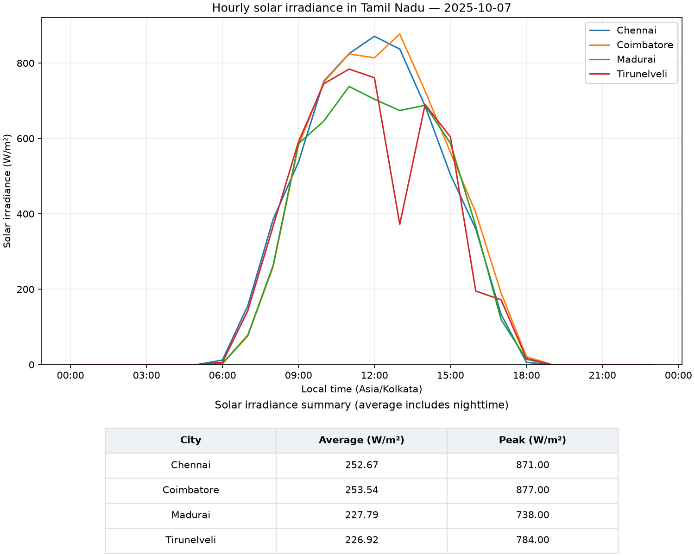
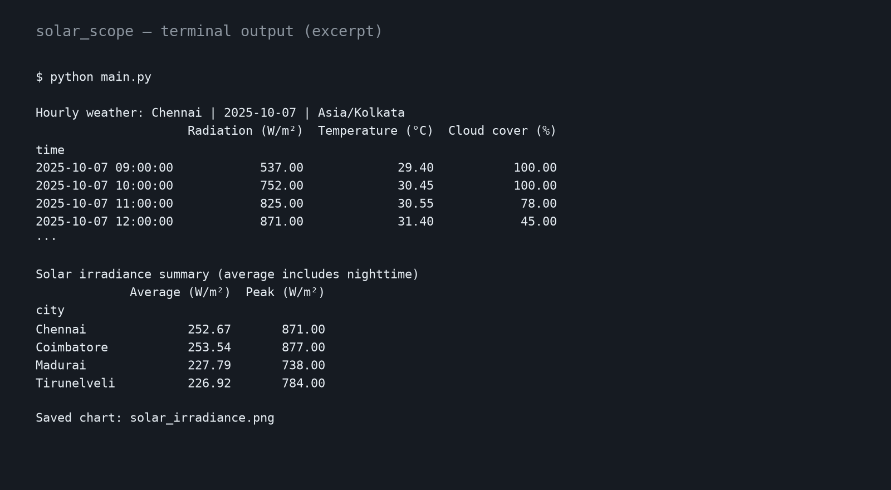

# Project Solar Scope

Comparing solar irradiance across cities in Tamil Nadu, India, using historical weather data from the Open-Meteo API, with Python, Xarray, and Matplotlib for data analysis and visualisation.

**Cities:**

- Chennai
- Coimbatore
- Madurai
- Tirunelveli

## Important Concepts

**Solar Irradiance:** Measures incoming solar power per unit area, typically in W/m².

**Formula:**

```text
Irradiance = incoming solar power (W) ÷ area (m²)
```


## Takeaways

- Getting weather data from an API.
- Working with NumPy arrays and Pandas tables.
- Organising data by time and city using Xarray.
- Comparing solar irradiance with a Matplotlib chart and average and peak values.

## How to Run

Install the required libraries and run the script:

```bash
pip install -r requirements.txt
python main.py
```

The script prints the weather data and summary, and saves a chart as `solar_irradiance.png`. You can change `DATE` in `main.py` to explore another day.

## Example Output

Solar irradiance comparison and summary for October 7, 2025:



A preview of the terminal output (shortened):


